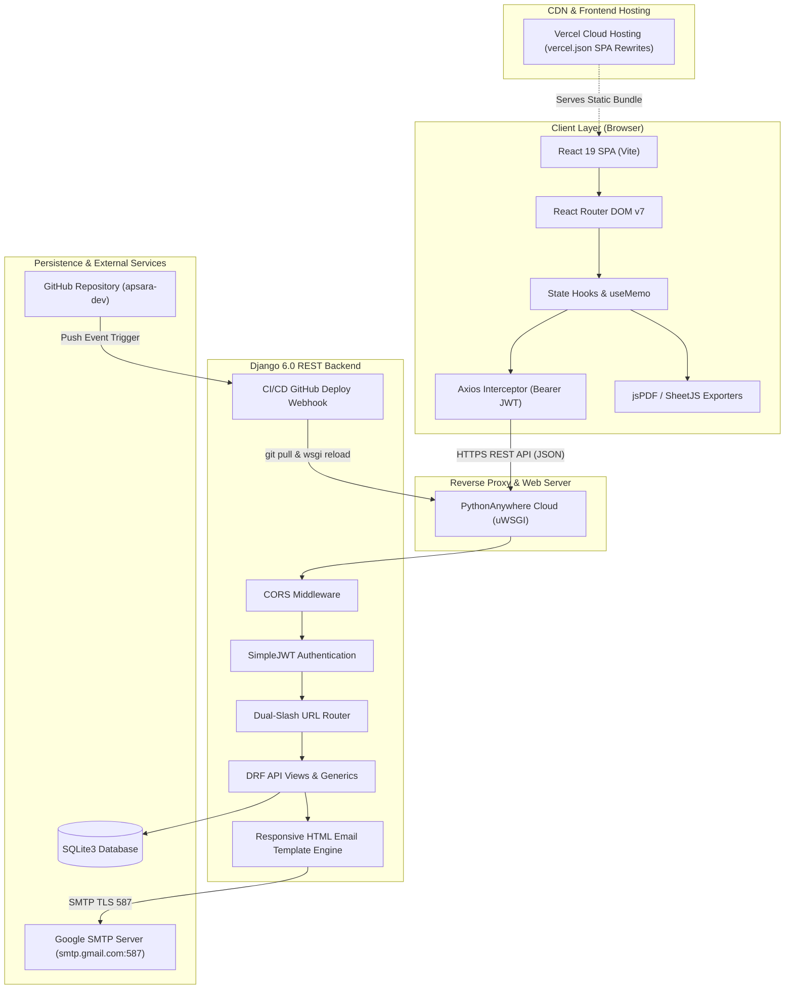
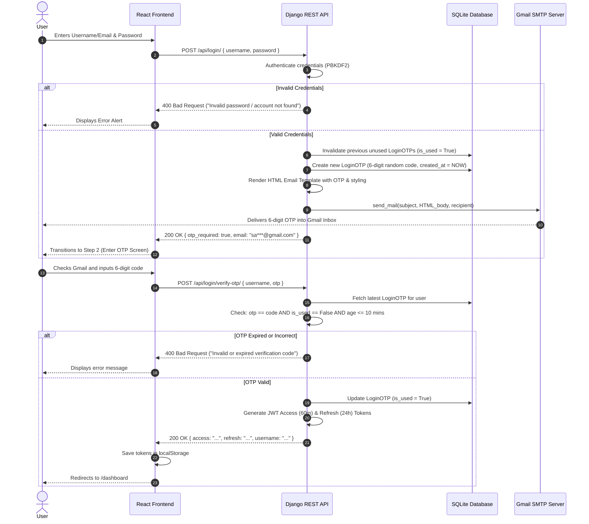
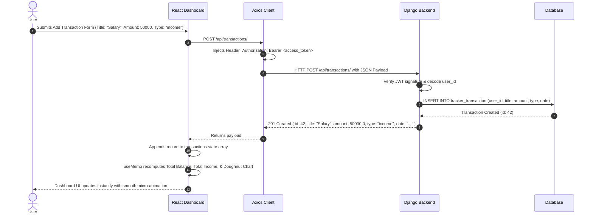
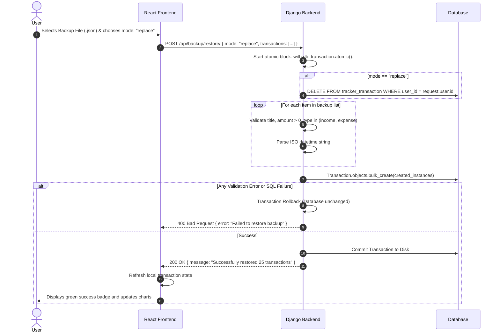
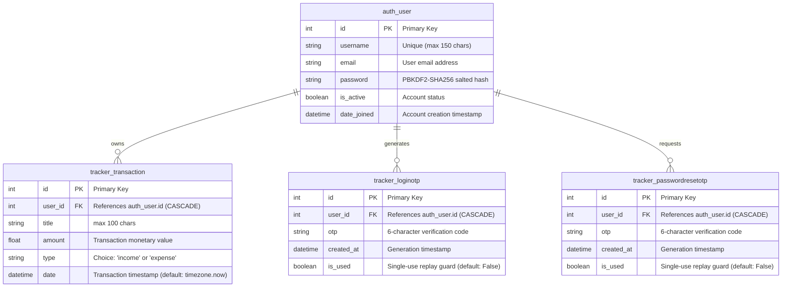
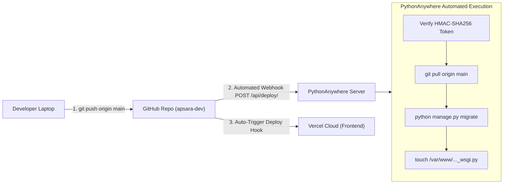

# FinTrack - Complete Master Engineering & Architecture Guide

> **Document Version:** 2.0  
> **Target Audience:** Examiners, Technical Interviewers, Project Evaluators & Developers  
> **Project Scope:** Enterprise-grade Full-Stack Personal Finance & Wealth Management Platform

---

## 1. Executive Summary & Project Vision

**FinTrack** is a state-of-the-art, full-stack personal finance and wealth management platform designed to solve modern budgeting, transaction tracking, and financial visibility problems.

Unlike basic CRUD expense loggers, FinTrack is architected with **decoupled micro-layers**, **stateless JWT authentication**, **Two-Factor Authentication (2FA) with OTP email verification**, **interactive data visualizations (Chart.js)**, **client-side spreadsheet/PDF document rendering**, and **atomic backup-and-restore capabilities**.

```
+----------------------------------------------------------------------------------------------------+
|                                      FINTRACK PLATFORM AT A GLANCE                                 |
+----------------------------------------------------------------------------------------------------+
|   Frontend: React 19 SPA (Vite)        |   Backend: Django 6.0 + DRF     |  Database: SQLite3 / PG |
|   Auth: SimpleJWT + 2FA OTP (10m TTL)  |   Email: Google SMTP (TLS 587)  |  Deploy: Vercel + PyAny |
|   Analytics: Chart.js Doughnut & Bar   |   Exports: Excel, PDF, Email    |  CI/CD: GitHub Webhook  |
+----------------------------------------------------------------------------------------------------+
```

---

## 2. Complete Features Directory

### A. Authentication & User Security
1. **User Registration:**
   * Validates duplicate username/email, minimum 4-character password, and password confirmation.
   * Dispatches a responsive, branded HTML Welcome Email via Google SMTP upon creation.
2. **Two-Factor Authentication (2FA) Login:**
   * Step 1: Validates username/email & password against Django's PBKDF2 hash.
   * Step 2: Generates a cryptographically randomized 6-digit OTP (10-minute validity) and emails it to the user.
   * Step 3: Verifies the code and issues JWT `access` (60m expiry) and `refresh` (24h expiry) tokens.
3. **Password Recovery via Email OTP:**
   * Dedicated two-step password reset workflow utilizing time-sensitive verification codes.
4. **JWT Auto-Injection:**
   * Pre-configured Axios request interceptor injects `Authorization: Bearer <token>` on every API call.
5. **Session Termination (Logout):**
   * Purges client tokens and application state; redirects immediately to login.

### B. Financial Management & Tracking
1. **Real-time KPI Summary Cards:**
   * **Total Balance:** Net liquid cash flow (Total Income - Total Expense).
   * **Total Income:** Aggregation of all salary, dividend, and freelance inflows.
   * **Total Expense:** Aggregation of outflows with dynamic expenditure percentage.
2. **CRUD Operations:**
   * Add, inspect, modify, or delete income and expense items with customizable titles, dates, and amounts.
3. **Monthly Budget Target Engine:**
   * User defines a monthly spending limit (e.g. ₹25,000).
   * The platform calculates budget consumption percentage, remaining funds, and visually alerts if expenditures exceed 80% or 100%.
4. **Time-Period Filters:**
   * Dynamic preset filtering: *All Time*, *This Month*, *Last 30 Days*, *This Year*, or *Custom Date Range*.

### C. Financial Intelligence & Visualizations
1. **Category Breakdown (Doughnut Chart):**
   * Groups expenditures by categorized buckets (Food, Rent, Shopping, Bills, Travel, etc.) to highlight spending leaks.
2. **Cashflow Trajectory (Bar Chart):**
   * Compares Income vs. Expense monthly progression to visualize savings momentum.
3. **Dynamic Search & Pagination:**
   * Instant, sub-millisecond client-side search filtering across transaction notes and amounts.

### D. Reporting & Export Suite
1. **Excel Spreadsheet Export (`.xlsx`):**
   * Generates structured `.xlsx` workbooks using SheetJS with metadata, timestamped headers, and summary rows.
2. **Printable PDF Financial Statement:**
   * High-definition multi-page statement rendering with custom styling via `jsPDF` and `html2canvas`.
3. **Email Financial Statement:**
   * Server-side financial summary compiled and sent as an automated email report to registered inboxes.

### E. Backup, Migration & Disaster Recovery
1. **Full JSON Backup Export:**
   * Downloads an encrypted, versioned snapshot of the user's entire financial dataset.
2. **Atomic JSON Backup Restore:**
   * Uploads past backups with two flexible modes:
     * **Merge Mode:** Combines backup transactions with existing transactions.
     * **Replace Mode:** Purges existing records and reinstates the backup dataset.
   * Wrapped in `django.db.transaction.atomic()` to guarantee all-or-nothing rollback on errors.

---

## 3. High-Level System Architecture Diagram



---

## 4. Sequence & Data Flow Diagrams

### 4.1 Two-Factor Authentication (2FA) Login Protocol



### 4.2 Transaction Creation & Cash Flow Re-calculation



### 4.3 Atomic Disaster Recovery & Backup Restoration



---

## 5. Database Schema & Entity Relationships



---

## 6. Complete REST API Specification

| Endpoint | HTTP | Auth | Description | Request Body | Response (Success) | Status |
| :--- | :--- | :--- | :--- | :--- | :--- | :--- |
| `/api/register/` | POST | None | Creates user & sends Welcome email | `{ username, email, password, confirm_password }` | `{ message, username, email }` | `200 OK` |
| `/api/login/` | POST | None | Step 1: Validates credentials, sends 2FA OTP | `{ username, password }` | `{ otp_required: true, message, email }` | `200 OK` |
| `/api/login/verify-otp/` | POST | None | Step 2: Validates OTP, issues JWT tokens | `{ username, otp }` | `{ access, refresh, username, email }` | `200 OK` |
| `/api/login/resend-otp/` | POST | None | Generates new OTP & resends email | `{ username }` | `{ message, email }` | `200 OK` |
| `/api/forgot-password/request-otp/` | POST | None | Requests password reset OTP | `{ email, username }` | `{ message, email }` | `200 OK` |
| `/api/forgot-password/verify-otp/` | POST | None | Verifies reset OTP validity | `{ email, otp }` | `{ message: "OTP verified" }` | `200 OK` |
| `/api/forgot-password/reset/` | POST | None | Resets user password using verified OTP | `{ email, otp, new_password, confirm_password }` | `{ message: "Password reset successfully" }` | `200 OK` |
| `/api/refresh/` | POST | None | Exchanges refresh token for new access token | `{ refresh: "<token>" }` | `{ access: "<new_token>" }` | `200 OK` |
| `/api/transactions/` | GET | Bearer | Returns all transactions of authenticated user | None | `[ { id, title, amount, type, date }, ... ]` | `200 OK` |
| `/api/transactions/` | POST | Bearer | Creates a new transaction | `{ title, amount, type, date? }` | `{ id, title, amount, type, date }` | `201 Created` |
| `/api/transactions/<id>/` | PUT | Bearer | Updates an existing transaction | `{ title, amount, type, date }` | `{ id, title, amount, type, date }` | `200 OK` |
| `/api/transactions/<id>/` | DELETE | Bearer | Permanently deletes a transaction | None | None | `204 No Content` |
| `/api/reports/send-email/` | POST | Bearer | Dispatches financial report to user email | `{ email?, income, expense, balance, budget }` | `{ message: "Report sent" }` | `200 OK` |
| `/api/backup/export/` | GET | Bearer | Exports full account dataset as JSON | None | `{ version: "1.0", count, transactions: [...] }`| `200 OK` |
| `/api/backup/restore/` | POST | Bearer | Restores account dataset (merge or replace) | `{ mode: "merge"|"replace", transactions: [...] }`| `{ message, restored_count }` | `200 OK` |
| `/api/deploy/` | POST/GET| Secret | CI/CD Webhook: pulls git, migrates, reloads | Query: `?token=<secret>` or HMAC header | `{ status: "success", reloaded: true }` | `200 OK` |

---

## 7. Deep-Dive Component Implementation

### 7.1 JWT Token Architecture & Axios Interceptors
In modern SPAs, storing session cookies across different domains (Vercel on `.vercel.app` vs. PythonAnywhere on `.pythonanywhere.com`) introduces third-party cookie restrictions (SameSite=None, Secure).  
FinTrack solves this by utilizing **Stateless JWTs in LocalStorage**:
* `access`: 60-minute Time-To-Live (TTL). Used for authorizing REST requests.
* `refresh`: 24-hour TTL. Used to silently obtain a new `access` token without forcing re-login.

```javascript
// src/api/axios.js
import axios from "axios";

const api = axios.create({
  baseURL: import.meta.env.VITE_API_URL || "https://apsarar.pythonanywhere.com/api/",
});

// Automatic JWT Bearer Token Injection
api.interceptors.request.use((config) => {
  const token = localStorage.getItem("access");
  if (token) {
    config.headers.Authorization = `Bearer ${token}`;
  }
  return config;
});

export default api;
```

### 7.2 Bulletproof Input Coercion & Crash Prevention
Web applications often crash when unexpected datatypes are submitted (e.g. numeric usernames from autofill extensions). FinTrack implements safe coercion:
```python
# tracker/views.py
raw_login = request.data.get("username", "") or request.data.get("email", "")
login_id = str(raw_login or "").strip()
password = str(request.data.get("password", "") or "")
```
Wrapping the entire login pipeline in a high-level `try...except` block ensures that any backend exception returns structured JSON (`{"error": "Login service error"}`) with status `500` rather than leaking raw Python tracebacks.

### 7.3 Responsive HTML Email Generation (`tracker/email_templates.py`)
Standard plaintext emails often land in spam folders or fail to convey branding. FinTrack implements a dedicated HTML email templating engine:
* **Table-based HTML structure:** Standard email clients (Outlook, Gmail Android/iOS) lack modern CSS Grid/Flexbox support. Clean nested `<table>` elements guarantee cross-client rendering consistency.
* **Pre-header Support:** Includes an invisible `<div>` containing the OTP code for instant preview in push notifications and inbox lists.
* **Typographic Letter-Spacing:** Monospace 6-digit badge with `letter-spacing: 8px` for effortless legibility.

---

## 8. Continuous Deployment (CI/CD) Architecture



---

## 9. Future Roadmap & Enterprise Plans

1. **Database Migration to PostgreSQL:**
   * Transition from SQLite to managed PostgreSQL on AWS RDS or Supabase for horizontal scaling and multi-tenant connection pooling.
2. **Automated Bank Feed Integration:**
   * Integrate Open Banking APIs (such as Plaid or Salt Edge) for automatic sync with real credit card and checking accounts.
3. **AI-Powered Predictive Financial Forecasting:**
   * Implement a Machine Learning linear regression model in Python to predict end-of-month cash balances based on historic spending velocity.
4. **Multi-Currency & Real-Time FX Conversion:**
   * Real-time exchange rate conversions (INR, USD, EUR, GBP) using a live currency rate API.
5. **Native Mobile App (React Native):**
   * Port the React 19 component library to React Native for native iOS App Store and Android Google Play distribution, reusing the same Django backend APIs.

---

## 10. Summary Checklist for Viva & Technical Interviews

| Topic | Key Concept to Highlight |
| :--- | :--- |
| **Architecture** | Decoupled RESTful architecture (React 19 Vite + Django 6.0 DRF). |
| **Authentication** | Two-Factor Authentication (2FA) with 10-minute OTP expiration and JWT stateless tokens. |
| **Email Service** | Google SMTP on port 587 TLS using 16-character App Passwords and responsive HTML tables. |
| **Data Safety** | ACID atomic backup restoration (`transaction.atomic()`), PBKDF2 salted password hashing. |
| **DevOps** | Zero-downtime uWSGI reloading via CI/CD Webhooks on PythonAnywhere + Vercel SPA rewrites. |
| **Data Visualization** | Chart.js dynamic calculations optimized using React's `useMemo` hook. |
